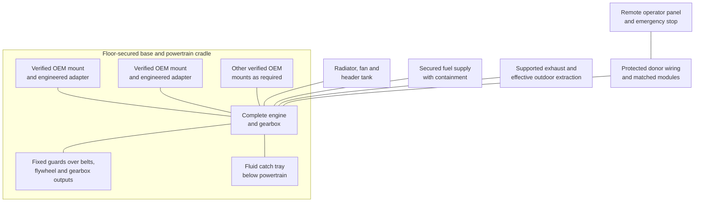
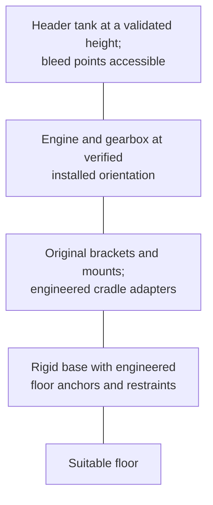
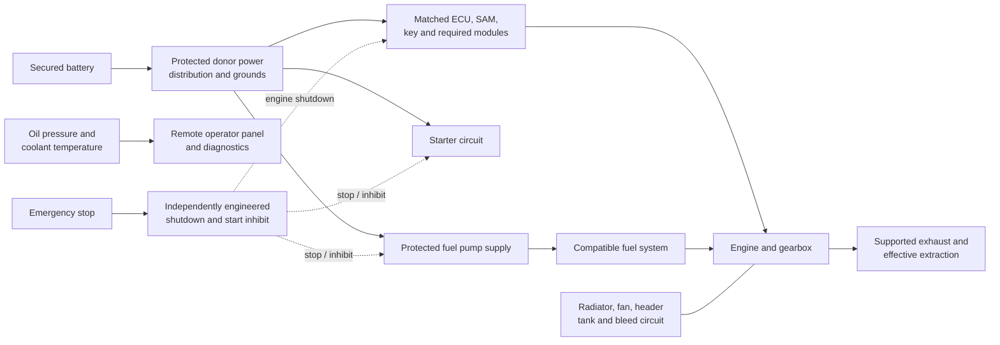

# M160 E07 LA engine-running stand

## Design status and intended use

This is a **preliminary design**, not a fabrication drawing or an approved
operating procedure. It describes a stand for an unmodified smart Roadster 452
M160 E07 LA engine and its matching gearbox, using donor electronics. It is
intended for supervised starting, idle, leak checks and limited no-load
diagnostics. It is **not** a dynamometer, a road-load simulator or a gearbox
test rig.

The actual engine, gearbox, mounts, loads and local operating environment have
not been measured. Consequently, no frame section sizes, weld sizes, anchor
ratings, fastener torques, fuel pressures or wiring pinouts are specified
here. A competent mechanical engineer and automotive electrician must finish
the design against the donor and approve it before fabrication or operation.

The published approximately 59 kg engine figure has an undefined ancillary
scope; it must not be used as the design weight for the complete powertrain
and stand. The [engine dossier](./smart-m160-e07-la-engine-dossier.md) records
the available evidence and its limits.

## Design concept

[Open the interactive 3D concept](./assets/m160-running-stand-3d.html).
It is a schematic visualisation: the engine, mounts and arrangement are not
measured and must not be used as fabrication geometry.

Use a low, rigid, floor-secured steel base with an adjustable cradle that
supports the complete engine/gearbox at its verified original installation
mounts. Retain the original brackets, mount geometry and engine attitude as
far as practicable. An intact donor rear subframe may be used **if** its
interfaces and load paths are inspected, measured and engineered into the
base; its presence alone does not establish that the stand is safe.

Keep the starter, flywheel, gearbox, engine accessories, engine harness and
original sensors installed. This avoids assuming that an engine-only starter
and flywheel arrangement is viable. Gearbox retention does not by itself
prove that the ECU will permit starting: the donor's start authorization,
neutral indication and control-module dependencies must be verified.

### Arrangement: plan view



This is a functional arrangement, not a scaled mounting drawing. Mount
quantity and position are determined by the donor, not by the three symbols.
Place the fuel system away from hot exhaust components and electrical
equipment; locate controls and the operator outside the rotating-parts plane
and away from hot surfaces.

### Arrangement: side view



The diagram does not establish a coolant hose routing or a header-tank height.
These must be designed and checked against the engine's cooling circuit.
Wheels, if fitted for transport, must not be relied on as the running
restraint; the stand must be secured to a suitable floor before operation.

### Proposed ancillary layout

The following is a starting layout for packaging, **not** a dimensional or
site-approved arrangement. The engine is shown schematically; its actual
orientation and the positions of its hot and belt sides must be established
from the donor before assigning the stand's left and right sides.

```text
                  PLAN VIEW - NOT TO SCALE

   OUTSIDE THE ENGINE/RIG AREA             RIG AREA
  +---------------------------+    +------------------------------+
  | Remote start/stop panel   |    | Radiator + guarded fan      |
  | and emergency stop        |    | clear airflow to atmosphere |
  +---------------------------+    +------------------------------+
                                             | coolant hoses
   SEPARATE FUEL AREA              +---------v--------------------+
  +---------------------------+    | Original mount interfaces   |
  | Secured tank/pump         |--->|     ENGINE + GEARBOX        |
  | and spill containment     |    | Tray underneath; guards on  |
  +---------------------------+    | belts and gearbox outputs   |
                                   +------------------------------+
                                        |                   |
                                +-------v------+    +-------v--------+
                                | Shielded hot |    | Battery, fuses |
                                | exhaust side |    | and ECU/SAM    |
                                +-------+------+    +----------------+
                                        |
                                 extraction to a
                                 safe outdoor location
```

The fuel area and electrical equipment must be separated from the exhaust,
hot surfaces and potential fuel spray. The diagram does **not** specify a safe
separation distance: establish this, ventilation and fire protection in the
site-specific risk assessment. Keep the radiator fan's inlet and discharge
clear, route coolant away from electrical equipment, and support hoses so
engine movement cannot chafe or pull on their connections. Keep the electrical
modules dry and accessible; route the harness away from the exhaust and
rotating parts. The exhaust needs its own support and allowance for engine
movement rather than being hung from the turbo.

## Mechanical design

### Measurement and interfaces

Before designing adapters, record the VIN, engine number, gearbox ID, existing
mount/bracket part numbers, and photographs of the donor installation. Survey:

1. The installed engine/gearbox orientation and the positions, axes and
   attachment surfaces of every mount needed to support and restrain it.
2. The complete assembly's mass and centre of gravity, including fluids,
   starter, alternator, turbo, exhaust parts and any retained subframe.
3. Cradle and base envelope, lifting points, access for servicing, and
   clearances at the sump, mounts, hoses, exhaust and moving parts.
4. Starter, flywheel, clutch, gearbox output and belt exposures; whether
   driveshafts can be removed or retained without compromising gearbox
   support or oil containment requires donor-specific verification.
5. The proposed floor, anchor locations and suitable operator, fuel, radiator
   and exhaust positions.

Use a common datum and record each mount's three-dimensional position and
orientation, bolt/hole details and measurement method. Obtain bolt grades,
engagement, tightening torques and permitted lifting/mounting points from the
applicable workshop information. Do not fasten load-bearing brackets to
unverified block holes, the sump, the exhaust or accessory castings.

### Engineering and fabrication requirements

- **Candidate material, not a released frame size:** consider certified
  EN 10219 structural hollow section in S355J2H, subject to the selected
  fabricator's welding procedure and the engineer's checks. For example,
  [SSAB's 355J2H catalogue](https://www.ssab.com/en/brands-and-products/ssab-domex/product-offer/tube-355-j2h)
  lists a 50 x 50 x 3.0 mm square section at 4.25 kg/m. That establishes a
  commercially available material and section, **not** that it is adequate
  for this stand. Obtain the actual product certificate and properties for
  the supplied grade, section and thickness.
- Design a closed, braced base and cradle with a continuous load path from
  powertrain mounts to floor anchors. Account for weight, offset centre of
  gravity, starting/stopping, vibration, torque reaction, foreseeable faults,
  handling and the actual operating environment.
- Select frame sections, plate thicknesses, welds, bolted joints, anchors and
  safety factors by calculation and review; no size in this document is a
  substitute for that work. Inspect welds and anchors to the approved design.
- Use the donor's mounts and brackets where sound, with adapters that do not
  preload the engine or gearbox. Provide an independently engineered
  restraint against excessive movement or a mount failure.
- Guard belts, pulleys, fan, flywheel/clutch and all gearbox outputs against
  contact and ejected parts. Guard design must allow for any foreseeable
  movement; a belt cover or an empty differential opening is not automatically
  a complete output guard.
- Keep the transmission in verified neutral and prevent unintended selection.
  Do not assume neutral or stationary outputs from a dashboard indication
  alone. The stand has no provision for running a driven output.
- Provide service access, a secured drip tray and safe lifting/handling
  arrangements. Remove lifting equipment before running.

## Support systems

### Cooling, intake and exhaust

Use a suitable radiator, fan, shroud, expansion/header tank, pressure cap,
hoses and thermostat circuit compatible with the donor. Engineer the hose
routing, high points, header-tank position, fill and bleed arrangement so that
the water pump and turbo cooling circuit operate as intended. A short stand
circuit is not necessarily equivalent to the car's long front-to-rear
plumbing. Verify coolant level, circulation, fan operation, temperature and
leaks during commissioning. Do not open a hot pressurised cooling system.

Retain the air filter, relevant intake sensors, charge-air plumbing,
intercooler and wastegate connections as appropriate for the engine and ECU.
Support the exhaust independently with flexible accommodation for engine
movement; shield the turbo and hot surfaces. Use exhaust extraction designed
for the engine's flow and temperature, discharging to a safe outdoor location,
plus effective ventilation and carbon-monoxide monitoring. An open workshop
door or a hose merely aimed outside is not proof of adequate extraction.

### Fuel system

Use a commercially suitable, securely mounted and contained petrol supply,
with compatible pump, filtration, pressure regulation, hoses and fittings
matched to the actual donor system. Confirm whether the donor uses a return
line and its specified pressure; do not assume either. Keep fuel and vapour
away from exhaust heat, sparks, electrical equipment and operator exits.
Provide appropriate isolation and a protected pump supply that stops on
emergency shutdown. Inspect and pressure/leak-test using the applicable
equipment and procedure before introducing ignition sources. Provide a
suitable accessible fire extinguisher and a spill response arrangement.

### Electrical and controls

Start with the intact donor electrical system and the staged, non-running
[electrical test-bed procedure](./smart-roadster-452-electrical-test-bed.md).
Preserve the matched ECU, SAM, key/immobiliser components, engine harness,
fuses, relays, battery cables, grounds and diagnostic connector. Retain the
gearbox control components and relevant network branches until their roles
are established for this specific donor; the exact minimum module set is
**unverified**. Use vehicle-specific wiring diagrams and diagnostic data.
Keep SRS and pyrotechnic devices disconnected.

Use a properly secured battery and appropriately rated, protected starter,
charging and control circuits. Provide a remote operator station with
ignition/start controls, emergency stop, diagnostics and visible oil-pressure
and coolant-temperature indication. Verify actual sensor readings and warning
thresholds for this engine rather than inventing values.

The emergency-stop circuit must be independently engineered and tested to
inhibit cranking and stop fuel delivery and engine operation, including
against a stuck control; its action and reset must not automatically restart
the engine. Do not rely solely on a scan-tool command or a single software
signal. Preserve any cooling or other functions needed for safe shutdown as
determined by the electrical design. A battery isolator is an additional
incident control, not a substitute for a tested engine-stop function;
disconnecting a battery while the alternator is operating can damage
electronics.

### Functional system diagram



The dashed lines express required functions, **not** a validated circuit or
pinout. The design must establish how shutdown is achieved and independently
verified for this donor, including a failure of a commanded output.

## Parts and design inputs

| Group | Required items / input | Status |
|---|---|---|
| Powertrain | Identified M160 E07 LA, matching gearbox, starter, mounts and ancillaries | Donor-specific |
| Structure | Survey, engineered cradle/base, mount adapters, restraints, anchors, guards and tray | Design and approval required |
| Cooling | Radiator, fan, tank, cap, hoses, compatible bleed and fan controls | Size and routing unverified |
| Fuel | Suitable contained tank, pump, filter, regulator, rated lines/fittings and isolation | Donor pressure and architecture unverified |
| Intake/exhaust | Filter, sensors, relevant charge-air components, supported exhaust, heat shielding and extraction | Donor and site-specific |
| Controls | Matched modules/key, harness, protected battery circuits, panel, emergency stop and diagnostic interface | Required module set and circuit unverified |
| Monitoring/safety | Oil-pressure and coolant-temperature indication, CO monitoring, fire and spill equipment | Thresholds and site assessment required |
| Documentation | VIN-matched workshop and wiring information, survey, engineering calculations, inspection and test records | Obtain before approval |

## Verification and staged commissioning

All stages are performed by competent personnel against the approved design.
Any unexplained movement, leak, smoke, abnormal noise, loss of indication or
failed safety function is a **stop** condition. Do not proceed to the next
stage until the fault is corrected and the affected checks are repeated.

1. **Design review:** confirm the intended use and site, donor survey,
   structural calculations, anchorage, guard coverage, electrical protection,
   shutdown design, fuel system, ventilation and fire controls.
2. **Build inspection:** inspect mounts, welds, fasteners, anchors, guarding,
   hose routing, hot-surface separation and containment. Confirm the
   powertrain cannot move beyond design limits.
3. **Electrical only:** with fuel isolated and the engine prevented from
   starting, follow the electrical test-bed stages. Check diagnostics,
   authorization, neutral/start conditions, fuses and grounds. Test the
   emergency stop, start inhibition and reset, including foreseeable faults,
   without an operating engine.
4. **Fluids and services:** fill and bleed using donor-specific procedures;
   verify fuel integrity, extraction, ventilation, fan controls, instrumentation
   and the absence of leaks. Confirm guarding and floor restraint.
5. **Controlled first run:** with a clear escape route and a trained operator
   at the remote stop, perform the approved first-start procedure. Observe oil
   pressure immediately, coolant temperature, fuel/coolant/oil leaks,
   vibration and exhaust extraction; stop on any abnormality. Confirm a normal
   stop and, when safe, the emergency-stop function under running conditions
   according to the approved test plan.
6. **Record:** retain measurements, photographs, calculations, wiring revision,
   module IDs, inspections, diagnostic faults and results. Do not increase
   speed or duration until behaviour and limits have been reviewed.

## Open decisions before a buildable design

- Exact engine/gearbox variant and the parts available from the donor.
- Whether a complete rear subframe is available and suitable for reuse.
- Measured mounting coordinates, assembly mass, centre of gravity and
  available floor/anchor capacity.
- Gearbox output arrangement, safeguarding and verified neutral/start logic.
- Required electronics and matched security components for the actual donor.
- Fuel circuit, cooling layout, exhaust extraction and site safety provisions.
- Required no-load test duration and operating range; loaded testing requires
  a separate dynamometer design.

## References

- [M160 E07 LA engine dossier](./smart-m160-e07-la-engine-dossier.md) —
  engine variants, installation context and evidence limits.
- [452 electrical test bed](./smart-roadster-452-electrical-test-bed.md) —
  donor harness and non-running electrical checks.
- [452 electrical schematic index](./smart-roadster-452-schematics-image-index.md) —
  leads to model-specific electrical drawings.
- VIN-matched Mercedes/smart workshop and wiring information — required for
  dimensions, service data, electrical connections and procedures; not yet
  incorporated into this preliminary design.
- [SSAB Domex Tube 355J2H](https://www.ssab.com/en/brands-and-products/ssab-domex/product-offer/tube-355-j2h) —
  manufacturer description and section/weight tables for EN 10219-compatible
  structural hollow section. This is material data, not a stand design.
- [452 powertrain figure index](https://smartcarmanuals.com/figures/452/powertrain/) —
  checked for mounting information; the indexed figure does not provide mount
  positions or dimensions.
