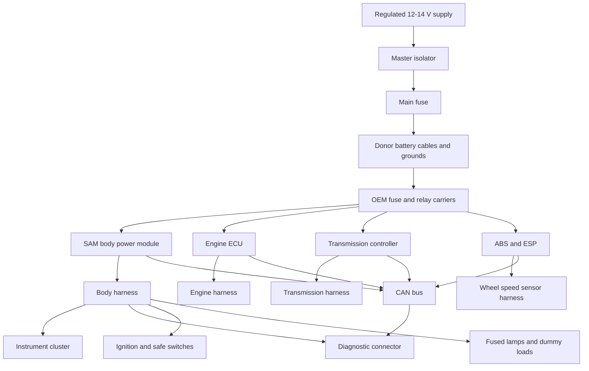
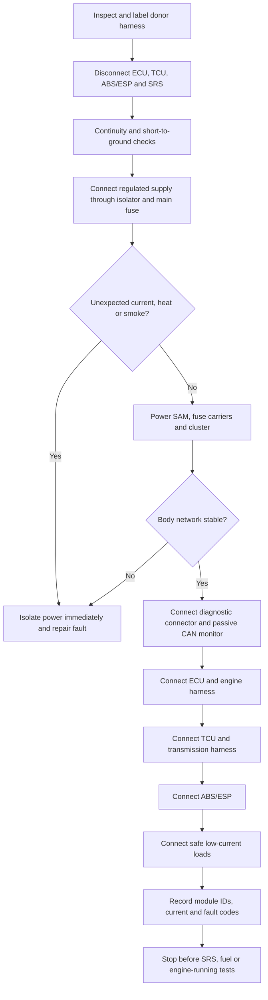
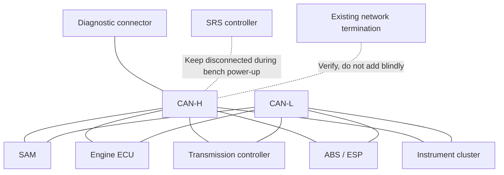
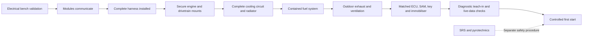

# Smart Roadster 452 electrical test bed

## Scope and safety

This procedure is for a **12 V electrical and module test bed** made from a
donor 452 harness. It is not a substitute for the OEM wiring diagrams,
diagnostic procedures or workshop safety instructions.

Do not bench-test airbags, seat-belt pretensioners, pyrotechnic devices, fuel
systems or an unrestrained running engine. Leave SRS components disconnected
until the complete harness is installed in the vehicle and the correct safety
procedure is available.

Do not bypass the immobiliser or attempt to clone/circumvent security systems.
Use the donor's matched keys/modules and lawful diagnostic equipment.

## What to preserve from the donor

Remove and label these as a matched electrical set:

- Main body harness
- Engine harness
- Door harnesses
- Roof/lighting harness branches
- Fuse and relay carriers
- SAM/body power module
- Engine ECU
- Transmission control unit and actuators
- ABS/ESP controller
- Instrument cluster
- Ignition switch and key/immobiliser components
- Diagnostic connector
- Battery cables and ground straps
- Relevant switches, sensors and loads

Photograph every connector before unplugging it. Record connector labels,
module labels, fuse ratings, wire damage and all grounds. Do not cut the harness
until continuity testing and connector identification are complete.

## Test-bed equipment

### Essential

- Regulated 12–14 V DC power supply with adjustable current limit
- Separate protected battery or laboratory supply for later high-current tests
- Main isolation switch
- Inline main fuse close to the supply
- OE fuse/relay carriers and correct fuses
- Digital multimeter with continuity, resistance and voltage-drop functions
- Insulated back-probes and breakout leads
- Current meter or DC clamp meter
- Test lamps or fused load modules
- Battery charger/maintainer for the donor battery
- Printed or licensed 452 wiring diagrams
- Fire extinguisher suitable for electrical and fuel-related work

### Useful

- Two-channel oscilloscope
- CAN interface that does not transmit until deliberately enabled
- Diagnostic tool with Smart/Mercedes module coverage
- Insulation tester suitable for low-voltage automotive wiring
- Label printer, terminal release tools and connector repair kit
- Insulated dummy loads for motors, lamps and solenoids

## Physical arrangement

Build the test bed around the donor's original power-distribution path:

1. Mount the regulated supply or protected battery at one end of a
   non-conductive bench.
2. Put the master isolator and main fuse as close to the power source as
   practical.
3. Connect the donor battery cables and main ground straps before connecting
   module power.
4. Mount the original fuse/relay carriers in an accessible, dry position.
5. Lay the body harness out without sharp bends and support it so connectors do
   not hang from their wires.
6. Place the SAM, diagnostic connector, cluster and ignition-switch wiring
   together as the body-control section.
7. Place the ECU and engine harness together, with engine sensors connected
   only when required for the current test.
8. Place the TCU and transmission harness together, leaving actuators
   mechanically secure and separately fused.
9. Keep ABS/ESP, SRS and other safety-related modules physically separated and
   clearly labelled.
10. Use protected test loads for lamps, relays and motors; do not leave unknown
    outputs connected to improvised loads.

The supply, isolator, main fuse, OEM fuse/relay carriers, grounds, harness and
modules should remain in the same electrical order as they are in the vehicle.
Keep exposed connectors away from metal benches and prevent accidental shorts.
Use donor ground straps, or temporary cables of equivalent current capacity.

### Bench architecture



SRS and pyrotechnic components are intentionally omitted from the powered
bench diagram and remain disconnected during these stages.

## Stage 0: identify and inspect

1. Photograph the complete harness and all module labels.
2. Record VIN, module part numbers, hardware numbers and software numbers.
3. Identify left/right-hand-drive and market-specific branches.
4. Inspect for water, green corrosion, overheated terminals, rodent damage and
   previous repairs.
5. Separate SRS/pyrotechnic branches and leave them unpowered.
6. Confirm every fuse and relay against the 452 schematic.
7. Mark unknown wires; do not assume that same-colour wires are interchangeable.

Reject or repair the harness before powering it if the SAM connectors, main
grounds or power feeds show water damage.

## Stage 1: unpowered continuity checks

With the supply disconnected and all modules unplugged:

- Check each main power feed for continuity from fuse carrier to connector.
- Check each ground branch to the main ground point.
- Check for unintended continuity between power and ground.
- Check CAN-H to CAN-L, CAN-H to ground and CAN-L to ground.
- Check each fuse position and relay socket against the schematic.
- Check connector pin retention and terminal back-out.

Do not use a high-current continuity tester. Record resistance values and
connector locations in the project evidence log.

## Stage 2: protected power-up

1. Disconnect ECU, TCU, ABS/ESP, SRS and all high-current loads.
2. Leave the fuse carriers and SAM connected.
3. Set the regulated supply to approximately 12.0–12.6 V.
4. Set a low current limit initially, typically 1–2 A.
5. Connect the negative supply to the donor main ground.
6. Connect the positive supply through the master isolator and an appropriate
   main fuse.
7. Power the system and observe current immediately.
8. Stop if current rises unexpectedly, a connector heats, smoke appears or the
   supply enters current limit.

Once the body/SAM circuit is stable, increase the current limit only as needed
for the identified load. Do not defeat the OE fuse strategy. Use a separate
fused branch for motors, lamps, relays and actuators.

### Staged power-up



## Stage 3: body and diagnostic network

With the engine, transmission and SRS still disconnected:

- Connect the diagnostic connector and instrument cluster.
- Confirm ignition-switch positions and wake/sleep behaviour.
- Check that the scan tool can identify the SAM, if supported.
- Check illumination, switches, indicators and safe low-current lamps.
- Test relay commands with appropriate dummy loads.
- Verify that the diagnostic connector has power and ground.
- Record every module that is present, absent or reporting undervoltage.

Do not clear all faults indiscriminately. Save the original scan report first.
Many faults are expected while major modules and loads remain disconnected.

## Stage 4: CAN-bus checks

Use the licensed wiring diagram to determine which CAN branches are present.
With power removed:

- Measure CAN resistance only after confirming the network topology.
- A complete correctly terminated network often measures about 60 ohms across
  CAN-H and CAN-L, but do not add a termination resistor merely to obtain that
  value.
- An open circuit, short to ground, short to supply or abnormal resistance must
  be isolated branch by branch.

With power applied:

- Observe recessive/dominant CAN activity with a scope or passive CAN tool.
- Confirm that adding one module does not collapse the network.
- Do not transmit arbitrary frames to control safety-critical modules.

### Module and CAN topology



The diagram is conceptual. The actual bus branches, termination and connector
locations must be taken from the applicable 452 schematic.

## Stage 5: module-by-module reconnection

Reconnect in this order, allowing the system to stabilize after each step:

1. SAM/body module and cluster
2. ECU and engine harness, with engine disconnected
3. TCU, with actuators disconnected
4. ABS/ESP, without hydraulic actuation
5. Non-safety sensors and switches
6. Low-current lamps and relays
7. Motors and actuators using separately fused supplies

After each stage, record:

- Supply voltage
- Current draw at rest and during wake-up
- Module identification
- Fault codes
- CAN status
- Heat, smell, noise or unexpected movement

## Stage 6: actuators and loads

Only test an actuator when its circuit, fuse, connector and mechanical travel
are understood:

- Use a current-limited, separately fused supply.
- Secure motors and linkages so they cannot strike people or wiring.
- Use a diagnostic actuation test where the tool supports it.
- Stop if an actuator stalls, chatters, overheats or exceeds expected current.
- Do not repeatedly cycle a clutch or gear actuator without the correct
  mechanical installation and diagnostic procedure.

Use lamps or approved dummy loads for lighting/relay tests. Do not leave an
unloaded relay output connected to an unknown resistor or improvised load.

## Engine-running boundary

A bench electrical rig does not become an engine test stand by adding power.
An engine-running test requires, at minimum:

- Secure engine and drivetrain mounting
- Complete cooling circuit with radiator and fan
- Fuel system designed for containment and fire safety
- Exhaust routed outdoors with suitable ventilation
- Correct ECU/SAM/immobiliser/key relationship
- TCU/clutch/gear system safely installed
- Oil pressure and coolant temperature monitoring
- Emergency stop and fire controls
- Vehicle-specific diagnostic and teach-in capability

For a restoration build, it is usually safer to install the complete powertrain
and harness in the chassis before attempting start-up.

### Engine-running boundary



## Test records

Create one record per test:

```text
test_id
date
donor_vin
module_or_circuit
diagram_revision
supply_voltage
current_limit
measured_current
load_state
fault_codes_before
fault_codes_after
result
next_action
photograph_or_scan_reference
```

## Source references

- [452 electrical figures and schematics](https://smartcarmanuals.com/figures/452/electrical/)
- [452 SAM electrical schematic](https://smartcarmanuals.com/manuals/2003-2006-smart-roadster-452-sam-electrical-schematic-de/)
- [452 SAM RHD wiring schematic](https://smartcarmanuals.com/manuals/2003-2006-smart-roadster-452-sam-wiring-schematic-rhd/)
- [452 complete figure index](https://smartcarmanuals.com/figures/452/)

The public figure pages are indexes to manual-derived material. Confirm the
diagram revision, market and connector numbering against the donor and a
lawfully obtained workshop source.
