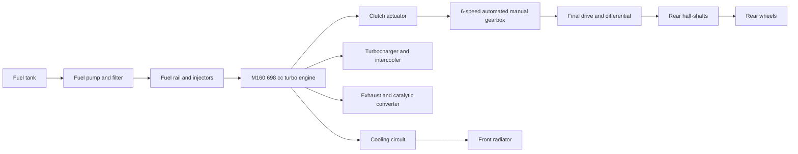
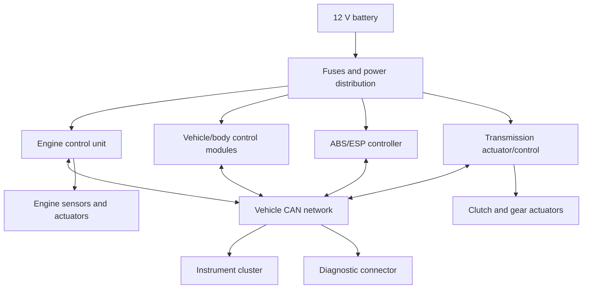
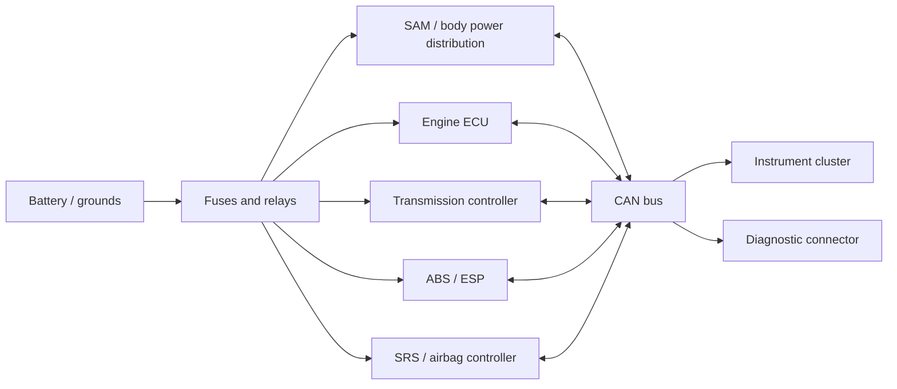

# Smart Roadster 452 / Roadster Coupé

## Project scope

This is a public-source reference dossier for the Smart Roadster family, internal
series **W452**. It covers the open Roadster and the removable-roof Roadster
Coupé, including the BRABUS and other output variants where public data is
available.

This document is a research baseline, not a workshop manual. Values can differ
by model year, market, equipment, body style, engine software and VIN. Safety-
critical work must be checked against the vehicle's official repair information
and measured on the individual car.

## Identity and production

| Item | Baseline information |
|---|---|
| Manufacturer/brand | Smart GmbH, associated with Mercedes-Benz |
| Internal series | W452 / 452 |
| Body | Two-door, two-seat roadster; Roadster Coupé fastback with removable hardtop |
| Layout | Rear-mid engine, rear-wheel drive |
| Production | Approximately August 2002 to November 2005 |
| Assembly | Hambach, France |
| Total production | Approximately 43,091 vehicles |
| Transmission | Six-speed electronically controlled automated manual |
| Engine family | Mercedes-Benz M160, three-cylinder turbocharged petrol |

The production dates and total are commonly reported as approximately 43,091;
confirm the exact production date and specification from the VIN/data card
before using this dossier for a particular car.

Some catalogues label the 452 as **2003–2006**, while historical summaries often
give **August 2002–November 2005**. This is likely a market/registration and
end-of-production convention difference; use the build date and VIN rather than
the catalogue year.

## Core specifications

| Parameter | Roadster reference | Roadster Coupé reference | Confidence / notes |
|---|---:|---:|---|
| Length | 3,427 mm | 3,427 mm | Public reference data |
| Width | 1,615 mm | 1,615 mm | Public reference data |
| Wheelbase | 2,360 mm | 2,360 mm | Public reference data |
| Height | About 1,192 mm | About 1,192 mm | Body/measurement source can vary |
| Curb mass | About 790 kg | About 810–815 kg | Equipment and source dependent |
| Fuel tank | 35 L | 35 L | Trim/source dependent; verify before service |
| Seating | 2 | 2 | Fixed |
| Drive | Rear-wheel drive | Rear-wheel drive | Fixed |
| Gearbox | 6-speed automated manual | 6-speed automated manual | Gear selection is electrohydraulic |

### Engine outputs

The 698 cc M160 E07 LA is the principal 452 engine. Public sources list several
calibrations:

| Variant description | Power | Torque | Application notes |
|---|---:|---:|---|
| Standard Roadster/Coupé | About 60–62 hp / 45–46 kW | About 95 Nm | Model-year and market dependent |
| Higher-output Roadster | About 82 hp / 61 kW | About 110 Nm | Common standard high-output calibration |
| BRABUS | About 99–101 hp / 74 kW | About 130 Nm | Hardware/software and trim-specific |

Parkers lists an 80 bhp Coupé at 111 mph, 0–60 mph in 10.6 s, 110 Nm and
698 cc. Its BRABUS index lists 101 bhp and 0–60 mph in 9.5 s. These are
catalogue figures, not guaranteed performance for an old or modified car.

## Vehicle architecture

### Mechanical system map

### Electrical/control system map

These are original functional diagrams. They intentionally do not claim OEM
connector pin numbers, wire colours, fuse ratings or diagnostic identifiers.

## Main systems and parts taxonomy

Use the following structure for a parts database. Every record should include
the VIN range, left/right-hand-drive status, body style, model year, source,
and whether the part is original, superseded, aftermarket or modified.

1. **Body and safety cell**
   - Tridion safety cell
   - Front/rear body panels and plastic clips
   - Doors, hinges, latches and window regulators
   - Windscreen, seals and mirrors
   - Roadster soft top and Coupé hardtop panels
2. **Chassis**
   - Front suspension arms, hubs and steering links
   - Rear suspension arms, hubs and driveshafts
   - Springs, dampers, anti-roll bars and bushes
   - Wheels, tyres and wheel fasteners
3. **Brakes and stability**
   - Hydraulic master cylinder and lines
   - Front/rear discs, pads and calipers
   - ABS/ESP sensors and hydraulic controller
4. **Powertrain**
   - M160 long engine and ancillaries
   - Turbocharger, wastegate and charge-air plumbing
   - Fuel delivery and evaporative-emissions components
   - Exhaust, catalyst and heat shielding
   - Six-speed gearbox, clutch, gear actuator and transmission wiring
5. **Cooling and lubrication**
   - Front radiator and long coolant pipes
   - Water pump, thermostat, expansion tank and hoses
   - Oil sump, pump, cooler/lines, filter and breather system
6. **Electrical and electronics**
   - Battery, starter and alternator
   - Engine ECU, body/SAM modules and instrument cluster
   - CAN wiring, grounds, fuses and relays
   - Sensors, actuators, immobiliser and key/remote system
7. **Interior and comfort**
   - Seats, belts and airbags
   - Heater/ventilation, optional air conditioning
   - Windows, mirrors, lighting, audio and instruments
8. **Service materials**
   - Engine oil/filter, coolant, brake fluid and gearbox fluid
   - Spark plugs, air filter, fuel filter and belts
   - Seals, O-rings, clips, fasteners and corrosion protection

## Known research and restoration topics

These are investigation categories rather than diagnoses:

- **Oil and coolant history:** document leaks, oil consumption, coolant level,
  thermostat behaviour and evidence of overheating before performance testing.
- **Turbo system:** inspect the actuator/wastegate, vacuum/pressure plumbing,
  intercooler hoses and charge-air leaks.
- **Automated manual shift quality:** scan for faults, check actuator operation,
  clutch adaptation and gear selection before replacing parts.
- **Cooling pipes and corrosion:** the engine is rear-mounted while the radiator
  is at the front, so the complete long cooling circuit must be inspected.
- **Water ingress:** inspect roof seals, door seals, drains, carpets, under-seat
  areas, electrical connectors and grounds.
- **Roof and Coupé panels:** verify correct latches, seals, storage pieces and
  panel compatibility by body style.
- **Brakes and tyres:** age, corrosion, tyre condition and ABS/ESP operation are
  more important than catalogue performance figures.
- **VIN identity:** record VIN, engine number, gearbox number, data-card option
  codes, market, build date and software version before parts lookup.

## Data-quality rules for this project

Each future parts or specification entry should carry:

- `vehicle_scope`: Roadster, Coupé, BRABUS, limited edition or all
- `model_year` and `market`
- `VIN_start` / `VIN_end` when known
- `source_url` and `source_date`
- `confidence`: confirmed, probable, catalogue-only or unverified
- `supersedes` and `superseded_by`
- `fitment_notes`
- `safety_critical`: yes/no

Do not treat a generic listing as proof of fitment. Photograph and measure the
installed part, and retain the original part number where possible.

## Public sources

1. [Smart Roadster - Wikipedia](https://en.wikipedia.org/wiki/Smart_Roadster)
   - Production history, layout, headline dimensions and mass.
   - Useful orientation source; the page itself warns that additional citations
     are needed, so verify critical values elsewhere.
2. [Mercedes-Benz M160 engine - Wikipedia](https://en.wikipedia.org/wiki/Mercedes-Benz_M160_engine)
   - Engine architecture and published M160 E07 output range.
3. [Parkers Smart Roadster Coupé 80 bhp LHD specifications](https://www.parkers.co.uk/smart/roadster/coupe-2003/(80bhp)-2d-auto-(lhd)/specs/)
   - Catalogue dimensions, 35 L fuel capacity, 810 kg listed mass, 698 cc,
     6-speed transmission, 110 Nm and equipment examples.
4. [Parkers Smart Roadster Coupé range](https://www.parkers.co.uk/smart/roadster/coupe-2003/specs/)
   - Publicly indexed standard, BRABUS, Finale and Racing Edition outputs.

## Gaps requiring primary documentation

The following should not be inferred from this dossier:

- Full OEM wiring diagrams, connector pinouts and fuse/relay assignments
- ECU/SAM/ABS/ESP software versions and coding procedures
- Exact torque settings, fluid specifications and service reset procedures
- VIN-specific parts supersessions and option-code fitment
- Crash-repair dimensions or structural straightening procedures
- Legal emissions, lighting and roadworthiness requirements for a particular
  country

The next evidence increment should be a VIN/data-card capture plus user-provided
photos, invoices and any legally obtained workshop documentation.

## Deeper technical reference

### Engine identification and operating data

The 452 uses the 0.7-litre M160 E07 LA family rather than the earlier 599 cc
M160 used in some 450 models. Public engine data gives the 0.7-litre engine a
66.5 mm bore, 67 mm stroke, aluminium construction, SOHC valvetrain, two valves
per cylinder, single turbocharging, fuel injection and water cooling. The
published engine-family range is approximately 50 to 101 PS, but only the
calibration fitted to the car should be used for parts or ECU work.

Useful identification fields:

| Field | Record from the vehicle |
|---|---|
| VIN | Full 17-character VIN |
| Engine number | Stamp/data card, not inferred from displacement |
| ECU hardware/software | Read with a compatible diagnostic system |
| Turbocharger ID | Photograph the identification plate before removal |
| Injector part number | Record all three; do not assume interchangeability |
| Catalyst/emissions label | Record market and homologation marking |
| Calibration | Standard, high-output, BRABUS or aftermarket |

Do not use the 101 PS BRABUS values to diagnose a standard engine. Boost control,
fueling, exhaust hardware, software and thermal load can differ.

### Transmission and actuator model

The gearbox is a conventional six-speed manual gearset operated by an automated
single-clutch system. It is not a torque-converter automatic and not a
dual-clutch transmission. The system has separate functions for:

1. Clutch release/engagement
2. Gear selection and engagement
3. Engine torque reduction during shifts
4. Gear-position and clutch-position feedback
5. TCU-to-ECU communication over the vehicle network

For diagnosis, record the following before replacing an actuator:

- Battery voltage during key-on, cranking and actuator operation
- Stored and pending ECU, TCU, ABS/ESP, SAM and SRS codes
- Selected gear versus actual gear
- Clutch bite/adaptation values, if supported by the scan tool
- Actuator noise, movement and mechanical resistance
- Gearbox oil level/condition and evidence of leaks
- Clutch slip under load and reverse engagement behaviour

A teach-in/adaptation procedure can correct learned-value drift after mechanical
work, but it cannot repair a worn clutch, damaged actuator, low voltage,
mechanical selector fault or hydraulic/electrical failure. Save the original
scan report before clearing adaptations or codes.

### Chassis and tyre baseline

Public owner/technical references report the following common road-use sizes and
pressures, but the door/fuel-flap label and wheel marking on the individual car
take precedence:

| Item | Common baseline |
|---|---|
| Front tyre | 175/55 R15 |
| Rear tyre | 195/50 R15 |
| Cold front pressure | About 1.9–2.1 bar |
| Cold rear pressure | About 2.3–2.4 bar |
| BRABUS wheels | 17-inch staggered fitment; verify wheel and tyre approval |

The staggered pressure is intentional because of rearward mass distribution.
Do not copy BRABUS pressures to a standard car or change tyre width without
checking wheel clearance, steering geometry, load index and local approval.

### Cooling and lubrication flow

The engine is rear-mounted while the radiator is at the front. That makes the
cooling system a long, distributed circuit rather than an engine-bay-only
system. A proper inspection should cover:

- Rear engine water pump and thermostat
- Expansion tank, cap and level sensor
- Rear hoses and clamps
- Underbody/front-to-rear coolant pipes
- Front radiator, fan and shroud
- Bleeding procedure and trapped-air symptoms
- Heater matrix flow and cabin temperature

An approximate public reference for 452 engine oil is 5W-40 ACEA A3/B4 and
about 3.0 L with filter. A public quick-reference source lists coolant at
approximately 4–5 L and brake fluid as DOT 4/MB 331.0. Treat these as planning
values only: confirm the exact approval and fill procedure in the applicable
workshop information.

### Water ingress investigation

Water ingress deserves its own inspection record because it can become an
electrical fault. Inspect in this order:

1. Dry the cabin and trunk completely; record baseline moisture.
2. Inspect roof seals, roof rails, windscreen surround and door seals.
3. Inspect trunk drains and rear-quarter drain paths.
4. Lift carpets and inspect the passenger-floor/SAM area.
5. Inspect connectors for green corrosion, capillary tracking and staining.
6. Perform a controlled water test in sections, not a high-pressure wash.
7. Photograph each leak path before applying sealant.
8. Re-test and record the repair material and date.

Sealant should not be used to hide a blocked drain or a displaced seal. A wet
SAM or corroded connector may require circuit testing and module replacement,
not simply drying the carpet.

### Electrical diagnostic boundary

The original electrical architecture is best documented as modules and network
interfaces, not guessed wire-by-wire:

For an electrical fault, capture voltage-drop measurements and connector
photographs. A generic OBD reader may not access the TCU, SAM, ABS/ESP or SRS;
use a tool with Smart/Mercedes module coverage and save a complete scan.

## Practical inspection worksheet

| Area | Pass criteria | Record |
|---|---|---|
| VIN/data card | All identifiers agree | VIN, engine, gearbox, market |
| Cold start | Starts promptly, stable idle, no warning lamps | Battery voltage, smoke, noise |
| Boost system | No unexplained smoke, whistle or low-power event | Hoses, actuator, scan data |
| Cooling | Reaches stable temperature without loss or fan abnormality | Level, leaks, temperature |
| Gearbox | All gears and reverse select without persistent faults | Adaptations, slip, noises |
| Brakes/ABS | Straight stop, no pulsation, no warning lamp | Disc/pad/line condition |
| Steering/suspension | No play, knocks or uneven tyre wear | Alignment and bush condition |
| Water ingress | Dry carpets/SAM area after controlled test | Leak path and repair |
| Roof/panels | All latches, seals and storage points work | Roadster/Coupé configuration |
| Electrical | Charging stable; all modules scan | Battery, alternator, module codes |

## Source confidence update

The additional public sources are useful but not equivalent:

- **Higher confidence:** manufacturer-derived figures reproduced by multiple
  independent catalogues; VIN-confirmed measurements; official service data.
- **Medium confidence:** Parkers catalogue data and Smart Car Manuals indexes,
  when the page identifies the chassis and engine clearly.
- **Lower confidence:** enthusiast guides, forum-derived part numbers, tuning
  pages and uncited special-edition claims.

The Smart Car Manuals pages are valuable indexes to publicly available manuals
and figures, but they explicitly instruct readers to verify parts and capacities
against the VIN/workshop manual. The Smart Roadster Tech pages are treated here
as community guidance only, not as factory specifications. In particular, do
not promote their alignment numbers, fluid intervals or suspension description
to confirmed data without primary documentation.

## Additional public references

5. [Smart Car Manuals - 452 model index](https://smartcarmanuals.com/models/452-roadster/)
   - Chassis overview, owner resources, manual indexes and common inspection
     topics; community-curated, so verify all values.
6. [Smart Car Manuals - fluids and specifications reference](https://smartcarmanuals.com/maintenance/fluids-spec-table/)
   - Planning values for 452 oil, coolant, brake fluid and tyre pressures; the
     page itself says to verify the workshop-manual specification.
7. [Smart Car Manuals - gear-ratio figure index](https://smartcarmanuals.com/figures/f3ff3f50c-gear-ratios-table-for-fortwo-and-roadster-smart-models/)
   - Index to a published gear-ratio figure; use the actual figure/manual for
     exact ratio transcription.
8. [Smart Car Manuals - maintenance schedule reference](https://smartcarmanuals.com/maintenance/maintenance-schedule/)
   - General age/mileage planning guidance; not a substitute for the 452
     service schedule.
9. [Smart Roadster Tech - suspension guide](https://smartroadster.tech/smart-roadster-suspension-setup-guide/)
   - Enthusiast setup guidance; use only as a hypothesis until checked against
     factory chassis data.
10. [Smart Roadster Tech - gearbox adaptation guide](https://smartroadster.tech/smart-roadster-gearbox-adaptation-reset/)
    - Community diagnostic explanation; adaptation procedures must be performed
      with a compatible tool and the correct vehicle-specific instructions.
