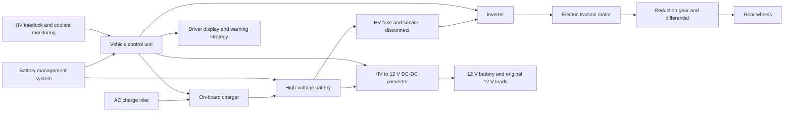
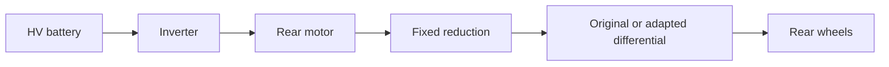
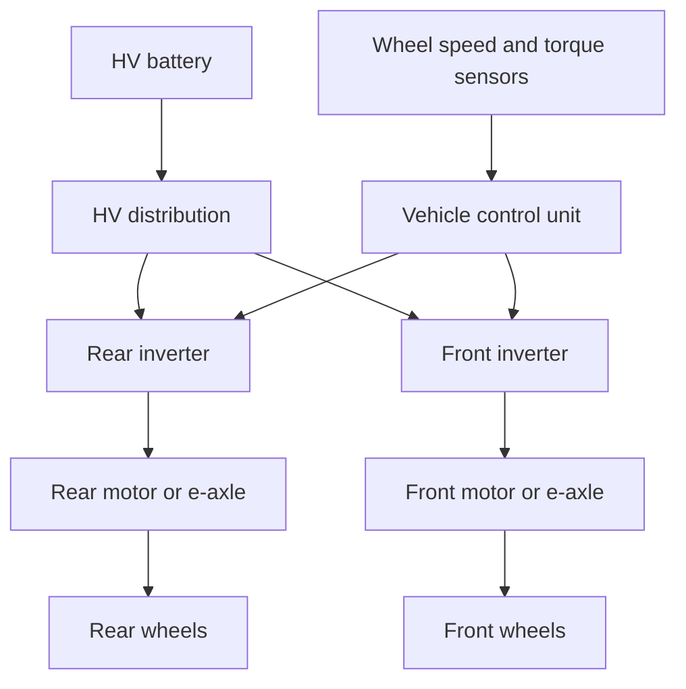
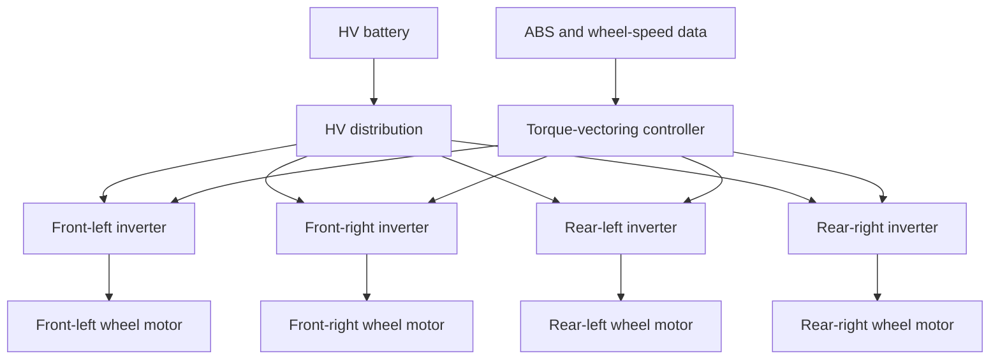
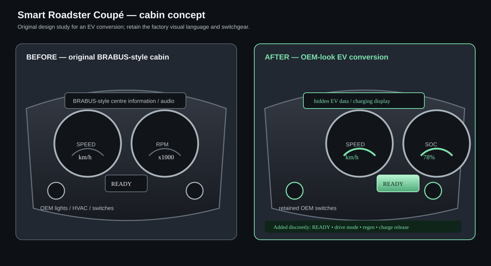
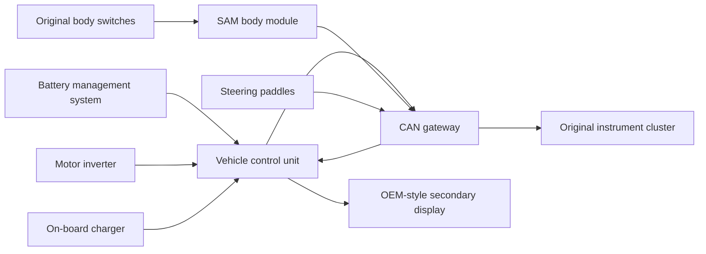

# Smart Roadster Coupé full-EV conversion

## Scope

This document covers a full battery-electric conversion of a 452 Roadster
Coupé intended to remain road legal and retain the character of a BRABUS car.
It is engineering planning guidance, not a certified conversion design.

High-voltage work requires trained personnel, insulated tools, lockout/tagout,
verified absence-of-voltage procedures and compliance with local approval rules.

## Functional architecture



## Main parts

### High-voltage system

- Battery modules or purpose-built battery pack
- Crash-protected, sealed battery enclosure
- BMS with cell-voltage and temperature monitoring
- HV main fuse
- Positive and negative contactors
- Pre-charge resistor and contactor
- Manual service disconnect
- HV interlock loop
- Insulation monitoring device
- Correctly rated orange HV cables and connectors
- Crash/inertia shutdown strategy
- HV warning labels and service barriers

### Propulsion

- Liquid-cooled permanent-magnet or induction motor
- Inverter matched to motor voltage/current
- Fixed reduction gearbox or adapter to the rear differential
- Motor mounts and torque-reaction structure
- Driveshaft/CV compatibility
- Resolver/encoder wiring
- Vehicle control unit
- Accelerator pedal interface
- Brake-pedal and regenerative-braking strategy
- Reverse and neutral control

### Charging and auxiliary systems

- AC charge inlet and locking mechanism
- On-board charger
- Charge control pilot/proximity circuitry
- DC-DC converter
- 12 V auxiliary battery
- Electric vacuum pump or brake-assist solution, if required
- Electric coolant pumps
- Electric cabin heater or heat-pump system
- Electric air-conditioning compressor, if retained
- Battery and inverter cooling loops
- State-of-charge and fault display

## Configuration options

### Light road conversion

| Item | Planning value |
|---|---:|
| Motor peak | 50–70 kW |
| Battery | 20–25 kWh usable |
| Nominal voltage | 250–320 V |
| Target converted mass | 850–950 kg |
| Approximate mixed range | 100–160 km |

This preserves lightweight handling but does not reproduce the full BRABUS
performance envelope.

### Balanced BRABUS-character conversion

| Item | Planning value |
|---|---:|
| Motor peak | 80–110 kW |
| Motor continuous | 45–65 kW |
| Battery | 30–40 kWh usable |
| Nominal voltage | 350–400 V |
| Target converted mass | 900–1,000 kg |
| Approximate mixed range | 150–220 km |
| AC charging | 6.6–11 kW |

This is the recommended starting envelope for a road-legal BRABUS-style Coupé.

### High-performance conversion

| Item | Planning value |
|---|---:|
| Motor peak | 120–160 kW |
| Motor continuous | 70–100 kW |
| Battery | 40–50 kWh usable |
| Nominal voltage | 400–450 V |
| Target converted mass | 1,000–1,150 kg |
| Approximate mixed range | 180–260 km |

This requires detailed axle-load, tyre, brake, cooling, differential,
driveshaft and structural analysis.

## Driveline architecture

| Architecture | Advantages | Main drawbacks |
|---|---|---|
| Motor to original gearbox | Reuses differential, driveshafts and rear geometry | Clutch, gear selection, lubrication and shifting become complex |
| Motor plus fixed reduction | Efficient, simple control and good packaging | Requires adapter, reduction stage and torque-reaction design |
| Integrated e-axle | Clean engineering and potentially high performance | Major mounts, driveshaft and subframe redesign |
| Dual rear motors | Torque-vectoring potential | Highest control, cooling, cost and approval complexity |

For a first road car, motor plus fixed reduction into the original differential
is usually the most coherent target. Retaining the manual gearbox is possible,
but adds complexity without being necessary for an 80–110 kW build.

## In-wheel motor and four-wheel-drive options

### Option 1: single rear motor, rear-wheel drive



This is the lightest and simplest option. It best preserves the 452's original
rear-drive character and leaves the front suspension largely unchanged.

### Option 2: dual-motor electric AWD



The most credible AWD arrangement is one compact motor/e-axle at each axle.
This keeps the motors sprung, allows independent torque control and avoids
putting a heavy motor in each wheel. It requires:

- Front motor/e-axle packaging and structural mounts
- Front differential or integrated reduction unit
- Front driveshaft and steering-clearance design
- Two inverters or a dual-channel inverter
- Coordinated torque control and wheel-speed feedback
- Brake/regen blending on both axles
- More battery current, cooling and HV distribution capacity
- Front axle-load and crash-structure validation

AWD can improve launch traction and wet-road stability, but it does not make
the car automatically safer. Torque must be limited by tyre grip and the
stability-control strategy.

### Option 3: four in-wheel motors

Four in-wheel motors provide independent wheel torque and potentially very
advanced torque vectoring:



This is technically possible but generally unsuitable as the first road-legal
452 conversion because:

- Motor and brake hardware compete for very limited wheel volume.
- Unsprung and rotating mass rise sharply.
- Steering, scrub radius, kingpin geometry and bearing loads change.
- Suspension travel and wheel clearance can be lost.
- HV cables must flex safely with steering and suspension movement.
- Wheel-end sealing, impact and water exposure become major risks.
- Four motors require more inverters, sensors, cooling and control validation.
- The original ABS/ESP system cannot simply be assumed to support the new
  torque sources.

In-wheel motors are better treated as a prototype or competition engineering
project than a straightforward BRABUS restoration.

### Option 4: two rear in-wheel motors

Two rear in-wheel motors avoid front steering complications but still add
unsprung mass and wheel-end HV/control complexity. They can provide rear torque
vectoring and eliminate the differential, but the wheel hubs, bearings,
brakes, driveshaft interfaces and suspension must be redesigned as a complete
system.

This is more feasible than four in-wheel motors, but usually less practical
than a sprung rear e-axle.

## AWD comparison

| Configuration | Drive | Main benefit | Main difficulty | Recommendation |
|---|---|---|---|---|
| Single rear motor | RWD | Lightest and most 452-like | Rear traction limit | Best first build |
| Rear dual motor/e-axle | RWD with torque vectoring | No mechanical differential requirement | Control and packaging | Strong option |
| Front and rear e-axles | AWD | Launch traction and stable power delivery | Front packaging and added mass | Best AWD architecture |
| Two rear in-wheel motors | RWD torque vectoring | Independent rear wheel torque | Unsprung mass and wheel-end reliability | Specialist project |
| Four in-wheel motors | AWD torque vectoring | Maximum control freedom | Extreme complexity and approval burden | Prototype only |

## Recommended AWD target

If four-wheel drive is essential, use **one sprung e-axle at the front and one
sprung e-axle at the rear**, not four in-wheel motors:

```text
Battery:                 35-45 kWh usable
System voltage:          350-400 V
Front axle:              30-50 kW continuous, torque-limited
Rear axle:               50-80 kW continuous
Peak combined power:     100-160 kW
Control:                 VCU with wheel-speed and yaw feedback
Brakes:                  Four-wheel hydraulic brakes plus blended regen
Cooling:                 Separate battery and motor/inverter loops
```

This remains a major structural and approval project. The front axle, steering,
crash structure, tyres, brakes, cooling, HV routing and stability-control
strategy all need professional design and testing.

## Battery placement

| Layout | Benefits | Risks |
|---|---|---|
| Central tunnel/underfloor | Low centre of gravity and central mass | Limited volume and enclosure complexity |
| Front luggage compartment | Balances rear motor mass | Crash structure, luggage loss and front axle load |
| Rear luggage compartment | Short HV cable path | Raises rear mass and reduces luggage space |
| Split front/central/rear | Flexible packaging and axle balancing | More enclosures, fusing and service points |

Preferred design goals:

- Keep mass low and close to the vehicle centre.
- Preserve luggage space where possible.
- Keep modules in sealed, crash-protected enclosures.
- Avoid suspension, occupant and impact intrusion zones.
- Keep service disconnects accessible without exposing live HV conductors.
- Validate front/rear axle loads at curb and maximum payload.

## Charging and voltage

| Option | Suitable use | Notes |
|---|---|---|
| 250–320 V, 6.6 kW AC | Light conversion | Lower component stress; less common hardware |
| 350–400 V, 6.6 kW AC | Balanced road car | Broad component availability |
| 350–400 V, 11 kW AC | Faster road charging | Requires suitable supply and approval |
| DC fast charging | High-use build | Adds cost, weight, thermal and approval complexity |

For a classic lightweight conversion, 6.6–11 kW AC charging is generally a
more appropriate first target than DC fast charging.

## Thermal systems

### Minimal single-loop

- Motor and inverter liquid loop
- Battery air cooling or conservative power limits
- Electric cabin heater

### Recommended two-loop road system

- Dedicated battery loop, pump and radiator
- Dedicated motor/inverter loop, pump and radiator
- Cabin heater on the appropriate loop or a separate PTC heater

### High-performance multi-loop

- Battery loop
- Motor/inverter loop
- Cabin/heat-pump loop
- Chiller or refrigerant coupling

Use the multi-loop design only when sustained power, fast charging or track use
justifies the added complexity.

## Performance estimation

```text
Wheel force = motor torque x reduction ratio x driveline efficiency / tyre radius
Acceleration force = wheel force - aerodynamic drag - rolling resistance
Energy at wheels = battery energy x drivetrain efficiency
Range = usable battery energy / measured road energy consumption
```

Illustrative character for a well-engineered 950 kg conversion:

| Motor peak | Approximate character |
|---:|---|
| 60 kW | Similar to a healthy standard Roadster; strong low-speed response |
| 80 kW | BRABUS-like or better acceleration |
| 100–120 kW | Very quick; serious cooling, traction and drivetrain review required |

Do not promise a 0–100 km/h time until motor torque, gearing, tyre grip,
vehicle mass, battery voltage and thermal limits are known. Instant electric
torque can exceed available grip and fatigue the original differential,
driveshafts and gearbox.

## Recommended project configuration

```text
Body:                    452 Roadster Coupé
Motor:                   Rear permanent-magnet motor
Driveline:               Fixed reduction into original differential
Peak power:              80-110 kW
Battery:                 30-40 kWh usable
System voltage:          350-400 V nominal
Charging:                6.6-11 kW AC
Battery layout:          Split central/front, subject to axle-load study
Cooling:                 Separate battery and motor/inverter liquid loops
Control:                 VCU with BMS, inverter, charger and safety interlocks
12 V system:             DC-DC converter plus new auxiliary battery
Brakes:                  Hydraulic system retained with validated regen blend
Target:                  Road-legal, responsive, BRABUS-like performance
```

This is a design target, not a parts order. Motor peak power, battery current,
gear reduction and tyre grip must be selected together.

## UK approval and certification route

This section assumes the vehicle will be used on public roads in Great Britain.
Northern Ireland, EU member states and other jurisdictions have separate
procedures. Confirm the route with DVLA, DVSA and an insurer before buying
high-voltage hardware.

### First decision: registered or not

- **Already UK-registered donor:** converting the fuel type to electric is a
  DVLA vehicle-detail change. The V5C must be updated, and DVLA may request
  evidence or inspect the vehicle. A standard IVA is not normally the first
  route for an already-registered car, but DVSA can advise whether voluntary
  IVA is appropriate for the extent of the conversion.
- **Unregistered, imported, rebuilt or newly constructed vehicle:** IVA may be
  required before registration. A vehicle previously registered in the UK
  cannot use ordinary IVA; the government guidance directs such vehicles
  towards voluntary IVA where applicable.

The existing registration, V5C, VIN, donor history and insurance category
should therefore be settled before dismantling. Do not buy a category A or B
write-off as the project shell.

### Practical UK sequence

1. **Keep the identity legal.** Obtain the V5C, verify VIN and record
   photographs, weights and the original specification. Avoid a donor with
   unresolved identity, serious write-off status or missing ownership
   documents.
2. **Ask DVLA/DVSA in writing.** Describe the proposed fuel-type change,
   battery location, motor power, revised mass, structural work and intended
   registration route. Keep their response with the build file.
3. **Freeze the engineering design.** Produce a mass and axle-load calculation,
   battery enclosure and restraint drawings, HV single-line diagram, isolation
   and interlock design, cooling design, brake/regen strategy and emergency
   shutdown method before ordering the battery.
4. **Build a traceable technical file.** Keep invoices, serial numbers, cell
   provenance, battery test results, charger/inverter/BMS datasheets, fuse and
   contactor ratings, cable specifications, insulation tests, earth-bond
   tests, torque records, weld/fabrication records and photographs.
5. **Use a competent HV engineer or conversion workshop.** There is no single
   government “EV conversion certificate” that makes an unsafe installation
   legal. Component CE/UKCA markings, UN 38.3 transport evidence or a BMS
   datasheet do not certify the completed vehicle.
6. **Complete independent inspection/testing.** Depending on the route, this
   may include a voluntary IVA or IVA inspection, brake performance checks,
   lighting and tell-tale checks, weight verification, electrical-isolation
   checks and inspection of battery restraint and HV protection.
7. **Update DVLA records.** Notify the fuel type and any other changed details
   such as mass, engine/cylinder-capacity fields, seating or body/chassis
   details. Submit any certificate or evidence DVLA requests.
8. **Obtain written insurance acceptance before road use.** Tell the insurer
   that the car is an individually engineered EV conversion and provide the
   final power, battery chemistry/capacity, value, workshop evidence and
   approval documents.
9. **Pass MOT and tax the vehicle.** An electric vehicle still requires normal
   road-safety items such as brakes, steering, suspension, tyres, lights,
   seat belts and body condition. The absence of an exhaust-emissions test
   does not remove those requirements.

### Main blockers before buying parts

| Potential blocker | Why it can stop or redesign the project | Resolve before |
|---|---|---|
| No V5C, uncertain VIN or category A/B donor | Identity or registration may be impossible | Buying the shell |
| Battery cannot be restrained without unsafe structural cutting | Crash protection and approval risk | Buying battery modules |
| Axle loads or gross weight exceed limits | Requires suspension, tyres, brakes or structural redesign | Final battery selection |
| No safe location for service disconnect, contactors and HV cables | Prevents maintainable and inspectable HV installation | Ordering the pack |
| Motor/inverter voltage, resolver and CAN interfaces do not match | Parts may be unusable as a system | Paying deposits |
| Regen strategy interferes with ABS/ESP or brake balance | Road safety and drivability issue | Road testing |
| Insurer will not cover an individually converted vehicle | The car cannot legally be used on the road | Major fabrication |
| Intended route actually requires IVA evidence | Late tests can force costly redesign | Final build |
| Battery provenance, isolation or thermal data is missing | Safety, transport and insurance evidence gap | Buying used modules |
| No qualified HV workshop or test facility | Unsafe commissioning and weak approval evidence | Energising the pack |

### Government references

- [DVSA individual vehicle approval guidance](https://www.gov.uk/vehicle-approval/individual-vehicle-approval)
- [DVSA IVA scheme guide](https://www.gov.uk/government/publications/guide-to-the-individual-vehicle-approval-iva-scheme)
- [IVA M1 passenger-car manuals](https://www.gov.uk/vehicle-approval/individual-vehicle-approval-manuals)
- [DVLA: change vehicle details on a V5C](https://www.gov.uk/change-vehicle-details-registration-certificate)
- [DVLA vehicle registration guidance](https://www.gov.uk/vehicle-registration)
- [UK motor insurance requirement](https://www.gov.uk/vehicle-insurance)

## Candidate parts and system families

These are starting points for an engineering comparison, not guaranteed
fitment recommendations. Confirm current availability, voltage range, cooling,
CAN protocol, certification and supplier support before purchase.

### Balanced rear-drive stack

| Function | Candidate system family | Why it fits the target |
|---|---|---|
| Motor | EMRAX 228 liquid-cooled or comparable automotive traction motor | Compact axial-flux package with a published 250–830 V range; power depends on winding, cooling and controller |
| Inverter | Cascadia Motion PM-series, Rinehart PM-series or equivalent automotive inverter | Suitable class for a liquid-cooled permanent-magnet motor; match voltage, phase current and resolver |
| BMS | Orion BMS 2, sized to actual series-cell count | Programmable CAN, contactor control, charge/discharge limits and cell monitoring |
| VCU | Automotive motorsport VCU or EV conversion VCU with documented CAN support | Coordinates accelerator, inverter, BMS, charger, DC-DC, brake and safety interlocks |
| Charger | Brusa, Elcon or equivalent 6.6–11 kW automotive AC charger | Select voltage/current range and regional charge protocol |
| DC-DC | Isolated 350–400 V to 12–14 V automotive converter | Supplies original 12 V loads and maintains the auxiliary battery |
| Battery | New automotive modules or tested matched OEM modules | Select by usable kWh, peak current, thermal behaviour and enclosure geometry |
| Cooling | Separate battery and motor/inverter liquid loops | Supports repeatable road performance and safer temperature control |

The EMRAX 228 manufacturer publishes a 228 mm diameter, approximately 13 kg
dry-mass motor with peak power up to 124 kW and continuous power up to 75 kW,
subject to winding, cooling and controller. That makes it a plausible candidate,
not proof that it fits the 452 without an adapter and mount design.

Orion BMS 2 documentation lists configurable series-cell counts, CAN interfaces,
cell monitoring, passive balancing and contactor-control functions. It must
still be selected for the actual cell count and pack architecture.

### Lower-cost donor-derived stack

| Function | Candidate approach | Main caution |
|---|---|---|
| Motor/inverter | Complete OEM EV drive unit from a production EV | The unit, inverter and resolver/position sensors must remain matched |
| Battery | Matched OEM modules with a documented BMS interface | Used modules need capacity, isolation and internal-resistance testing |
| VCU | Conversion VCU that supports the chosen donor inverter | CAN reverse-engineering can become the main project |
| Charger/DC-DC | Matching OEM charger and DC-DC or documented aftermarket replacements | Confirm charge protocol, isolation and cooling |
| Safety | New fuse, contactors, pre-charge, service disconnect and interlock | Do not assume donor crash logic transfers to the 452 |

Donor-derived systems can reduce cost but increase software integration and
packaging work. Do not mix random modules from different EVs unless the
interfaces and safety functions are fully documented.

### AWD stack

For AWD, use two sprung drive units where possible:

- Front compact e-axle or motor/reduction assembly
- Rear compact e-axle or motor/reduction assembly
- One inverter per motor, or a validated dual inverter
- VCU with front/rear torque allocation
- Wheel-speed, steering-angle and yaw-rate inputs
- Battery, contactors, fuse and cable set sized for combined peak current
- Separate thermal branches or a validated shared cooling system
- Brake controller and regenerative-braking blend strategy

The front motor must be checked against steering rack, suspension, crash
structure, driveshaft angle, wheel clearance and front axle load. A rear motor
plus front e-axle is normally more credible than four in-wheel motors.

### In-wheel motor systems

In-wheel motors should be treated as prototype-grade for this project. Candidate
suppliers exist, including purpose-built hub-motor manufacturers, but the motor
alone is not a conversion system. It also requires:

- Redesigned hubs, bearings and brakes
- Wheel-end sealing and impact protection
- Flexible HV and signal routing through steering/suspension movement
- New suspension and steering geometry
- Four independent inverters or a validated multi-channel inverter
- Torque-vectoring and traction-control software
- Unsprung-mass and ride analysis

Do not select an in-wheel motor from its peak power rating alone. Wheel
clearance, bearing loads, unsprung mass and legal braking performance are the
governing constraints.

## Selection rules

Before buying any candidate part, confirm:

1. Nominal and maximum battery voltage compatibility.
2. Continuous and peak current at the intended duty cycle.
3. Motor/inverter resolver, encoder or position-sensor compatibility.
4. CAN message definitions and configuration tools.
5. Contactor, pre-charge and insulation-monitoring interfaces.
6. Cooling flow, pressure, fluid and heat-rejection requirements.
7. Physical dimensions, mounts, service access and crash restraint.
8. Availability of manuals, firmware, spare parts and supplier support.
9. EMC, electrical isolation and road-approval evidence.
10. Whether the part is new, tested used, remanufactured or experimental.

## Candidate supplier references

- [EMRAX 228 motor](https://emrax.com/e-motors/emrax-228/)
- [Orion BMS 2](https://www.orionbms.com/products/orion-bms-standard/)
- [Electrogenic](https://www.electrogenic.co.uk/) — UK EV powertrain OEM,
  bespoke conversion engineering and conversion-kit supplier. Ask whether
  they will quote a one-off 452 Coupé integration; no 452 kit is assumed here.
- [Electric Classic Cars](https://www.electricclassiccars.co.uk/) — UK
  bespoke classic-car conversion workshop. Treat this as a possible design
  and installation enquiry rather than a confirmed 452 service.
- [Cascadia Motion](https://www.cascadiamotion.com/) — automotive inverter and
  power-electronics manufacturer.
- [Rinehart Motion Systems](https://www.rinehartmotion.com/) — automotive
  inverter and controller manufacturer.
- [BRUSA HyPower](https://www.brusa.tech/) — automotive on-board charging,
  DC-DC and power-electronics manufacturer.
- [BRABUS](https://www.brabus.com/) — original manufacturer reference only;
  current 452 Coupé parts availability must be confirmed by part number.
- [Mercedes-Benz Classic](https://www.mercedes-benz.com/en/classic/) —
  possible route for historical parts guidance; it is not evidence that a
  452 or BRABUS part remains available.
- [Smart Car Manuals 452 EV-related source index](https://smartcarmanuals.com/models/452-roadster/)

These supplier examples are not endorsements, and availability or product
lines can change. Fellten, for example, currently presents universal battery
packs and energy-storage products rather than a documented 452 conversion kit.
Obtain a written quotation, technical datasheets, warranty terms, delivery
lead time and UK support details before treating any supplier as suitable.

### Recommended procurement route

| Requirement | Most credible route | What must be confirmed |
|---|---|---|
| Complete design, fabrication and installation | UK EV conversion workshop such as Electrogenic or Electric Classic Cars | 452 experience, HV approval process, insurance, IVA/MOT route, battery packaging and post-build support |
| Motor and inverter | EMRAX or another automotive motor OEM plus a matched inverter supplier | Winding, resolver, voltage, peak/continuous current, cooling and reduction ratio |
| BMS and safety controls | Orion BMS 2 or equivalent automotive BMS integrator | Cell chemistry, series count, contactors, pre-charge, isolation monitoring and CAN documentation |
| Charger and DC-DC | BRUSA, Elcon/TC Charger or equivalent automotive supplier | UK AC charge standard, voltage window, isolation, cooling and service support |
| Battery modules or pack | New automotive modules or a UK/EU pack builder | Cell provenance, test report, enclosure, crash restraint, thermal management and replacement plan |
| Original 452/BRABUS parts | Mercedes-Benz Classic enquiry, specialist dismantlers, donor vehicle and used-parts marketplaces | VIN/option fitment, exact part number, condition, returns and corrosion/water damage |
| OEM-look instruments and switches | Reuse original 452 housings and switchgear; commission a CAN display/gateway specialist | Warning-lamp behaviour, legal tell-tales, CAN translation, EMC and serviceability |

For this project, the safest purchasing sequence is: secure a complete donor,
freeze the EV architecture, obtain a compatibility matrix from one integrator,
then buy the motor, inverter, BMS, charger, DC-DC and battery as a matched
package. Do not buy an isolated motor or battery first and assume the remaining
interfaces will be easy to resolve.

## Stacking two EMRAX 228 motors

The EMRAX 228 manufacturer describes stacking two motors to achieve doubled
power and torque. Using the published single-motor headline values as a
theoretical upper bound:

| Parameter | One EMRAX 228 | Two stacked |
|---|---:|---:|
| Peak power | Up to 124 kW | Up to 248 kW |
| Continuous power | Up to 75 kW | Up to 150 kW |
| Peak torque | 220 Nm | 440 Nm |
| Continuous torque | Up to 130 Nm | 260 Nm |
| Motor dry mass | About 12.9–13.5 kg | About 25.8–27 kg |
| Efficiency | Up to 96% | Controller, speed and cooling dependent |

These are not guaranteed vehicle outputs. The actual result depends on the
selected winding, voltage, controller, cooling, speed, duty cycle, reduction
ratio and battery current capability.

### Electrical consequences

At 400 V, delivering 248 kW to the motors requires approximately:

```text
248,000 W / 400 V = 620 A ideal
```

Allowing for inverter and cable losses, the pack could need roughly 650–700 A
at peak. At 350 V, the ideal current is approximately 709 A before losses.
That requires a high-current battery, contactors, fuse, busbars, cables, BMS,
inverter system and cooling design. A 30–40 kWh battery may support this only
if its cell chemistry and parallel count are deliberately designed for the
peak-current demand.

Two stacked motors also need:

- Two compatible inverter channels or a validated dual-channel inverter
- A mechanically engineered stacked rotor/shaft and housing arrangement
- Motor mounts able to handle approximately double torque reaction
- Reduction gearing and differential rated for the torque
- Larger driveshaft/CV and hub safety margins
- More battery and inverter cooling capacity
- Torque ramp limits to protect tyres and driveline
- A VCU capable of controlling the combined motor system

### Vehicle result

In a roughly 950 kg conversion, 248 kW is approximately 261 kW per tonne.
That is far beyond the original standard or BRABUS power-to-weight range.
With a typical reduction ratio and road tyres, theoretical wheel force would
be traction-limited before the motors reached their full torque capability.
The original 452 differential, driveshafts, hubs, tyres, brakes and suspension
would require substantial engineering review.

Two stacked EMRAX 228 motors could therefore produce an extremely fast
prototype, but they are not a sensible first specification for a road-legal
BRABUS-style Coupé. One EMRAX 228 limited to approximately 80–110 kW peak,
or a smaller motor sized to the target, is more likely to preserve reliability,
handling and approval feasibility.

## OEM-look dials, displays and switches

The cabin does not need to look like a universal aftermarket conversion. The
best result is to preserve the original 452 touch points and replace only the
information and control layer behind them.



This is an original concept illustration, not a photograph or factory drawing.

### Instrument configuration A: retained original cluster

Keep the original cluster, steering-wheel controls, warning lamps and stalks.
Use a VCU/CAN gateway to provide the signals needed for:

- Vehicle speed
- Ready-to-drive state
- State of charge
- Battery warning
- Motor/inverter fault
- Reduced-power warning
- Direction/gear state
- Turn signals and high beam
- Brake-system and stability warnings

Advantages:

- Most authentic appearance
- Original mounting and illumination
- Existing legal warning indicators remain visible
- No new dashboard cut-outs

Limitations:

- The original cluster may expect combustion-engine ECU messages.
- Some values may require a CAN gateway or custom cluster interface.
- Warning-lamp behaviour must be validated rather than assumed.

### Instrument configuration B: custom display inside original housings

Retain the original gauge pods and bezels, but install a small automotive CAN
display or custom LCD/OLED behind the original faces. This allows:

- Speed
- State of charge
- Battery power
- Motor temperature
- Battery temperature
- Pack voltage/current
- Estimated range
- Drive/neutral/reverse/ready state
- Charge status

Use the original needles, printed faces and warning-light positions where
possible. A custom faceplate should preserve the original visual hierarchy and
night illumination rather than exposing a flat tablet-style screen.

### Instrument configuration C: hidden auxiliary display

Retain the original cluster for road information and add a small secondary
display in an existing centre-console or accessory location for:

- Detailed battery data
- Charging information
- Diagnostic faults
- Temperature pages
- Service data logging

This is usually the least visually intrusive way to expose engineering data.

### Recommended instrument layout

```text
Original left dial:       Vehicle speed and legal warning lamps
Original right dial:      EV state-of-charge / power display in OEM style
Original centre controls: HVAC, lights, wipers, indicators and hazards
Hidden/secondary display: Temperature, voltage, current, faults and charging
```

Do not remove or conceal legally required warning indicators. The final warning
strategy must be agreed with the inspection/approval authority.

## Switch and control options

### Reuse original switches

Retain the original:

- Ignition/key position or approved start authorization
- Headlamps and exterior lighting
- Indicators and hazard switch
- Wiper and washer controls
- Interior lighting
- Heated seats, if fitted
- HVAC controls
- Window switches
- Door and roof/Coupé controls

Route their outputs through the original body/SAM wiring where practical. The
VCU should receive propulsion commands separately from body-control commands.

### Add discreet EV controls

Add only the controls that the EV system genuinely needs:

- Start/stop or “Ready” button
- Forward/neutral/reverse selector
- Drive-mode selector
- Regenerative-braking level
- Charge-port release
- Cabin preheat or battery-conditioning command
- Manual HV service disconnect, kept out of normal driver use

Use an existing blank switch position, centre-console location or a custom
BRABUS-style panel rather than cutting the main dashboard. Match the original
font, backlighting colour, switch texture and fastener style.

### Steering-wheel controls

The original paddle shifters can be repurposed for:

- Regenerative-braking increase/decrease
- Temporary power or drive-mode selection
- Manual regen override

They should not be presented as gear changes unless the drivetrain actually has
multiple ratios. The VCU must debounce the switches and provide a safe default
if a paddle or CAN input fails.

## Cabin integration comparison

| Approach | Visual result | Engineering effort | Recommendation |
|---|---|---:|---|
| Original cluster plus CAN gateway | Closest to factory | Medium/high | Best authenticity |
| Original housings with custom CAN display | Factory-like and flexible | High | Best technical result |
| Original cluster plus hidden auxiliary display | Very discreet | Medium | Best restoration compromise |
| Universal tablet/digital dash | Clearly converted | Low/medium | Avoid for this build |
| Exposed motorsport dash and switch panel | Competition appearance | Medium | Only if intentionally desired |

## EV display data path



The gateway must have a defined message map, watchdog behaviour and fail-safe
state. Do not inject guessed CAN messages into the original vehicle network.

## Conversion test sequence

1. CAD/package study and axle-load calculation.
2. HV enclosure and crash-load design.
3. Motor/inverter bench test with no vehicle connection.
4. Battery/BMS/contactor/pre-charge test using a safe current-limited setup.
5. 12 V and VCU test with HV disabled.
6. Low-speed wheel-off-ground direction test.
7. Controlled low-speed road test on private land.
8. Brake, thermal, insulation and emergency-shutdown validation.
9. Range, charging, EMC and roadworthiness testing.

## Road-legal requirements

An EV conversion can require approval, updated registration, electrical safety
evidence, braking validation, lighting changes, weight and axle-load
verification, insurance disclosure and inspection. Requirements vary by
country. Obtain the approval pathway before buying expensive HV components.

## Related project documents

- [Electrical conversion options](./smart-roadster-electrical-conversion-options.md)
- [BRABUS Coupé build BOM](./smart-roadster-brabus-coupe-build-bom.md)
- [Electrical test-bed procedure](./smart-roadster-452-electrical-test-bed.md)
